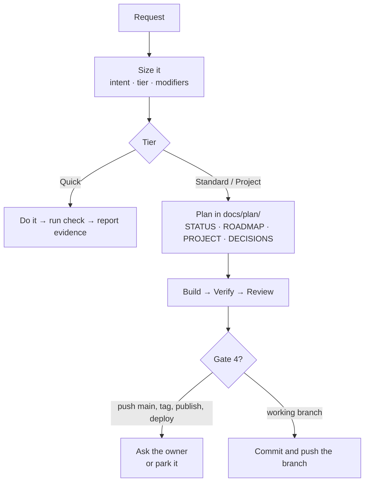

<div align="center">


# Northstar

**A software-development skill for coding agents that ships useful work, not perfect work.**

Northstar sizes every task in one line, guards your git, keeps pasted secrets out of the repo, and keeps long autonomous sessions making verified progress instead of polishing.


</div>

---

## Install

**Windows (PowerShell)**

```powershell
irm https://raw.githubusercontent.com/joebenberry-afk/northstar/main/install.ps1 | iex
```

**macOS / Linux / Git Bash**

```bash
curl -fsSL https://raw.githubusercontent.com/joebenberry-afk/northstar/main/install.sh | sh
```

**From a clone**

```bash
git clone https://github.com/joebenberry-afk/northstar.git
cd northstar && ./install.sh   # or .\install.ps1
```

The installer copies `northstar/` to two places:

| Path | Used by |
|---|---|
| `~/.claude/skills/northstar` | Claude Code |
| `~/.agents/skills/northstar` | Codex, OpenCode, OMP |

Run it again to update. Uninstall by deleting both folders.

## What it does

Every software request starts with one line:

```
Northstar: fix · Quick
Northstar: build · Project +critical
```

| Part | Values |
|---|---|
| **Intent** | build · modify · fix · investigate · refactor · review · harden · release · maintain |
| **Tier** | **Quick** (local, low risk) · **Standard** (feature or bounded repair) · **Project** (architecture and milestones) |
| **Modifiers** | **+research** (hypothesis and decision rule set before running) · **+critical** (auth, secrets, data deletion, migrations, payments) |

Rigor follows risk, not file count. Quick work skips all the ceremony: do it, check it, report the evidence.



### Rules that always hold

- **Intent fidelity:** goals and non-goals change only with your approval.
- **Evidence:** nothing is "done" without recorded output from the acceptance check.
- **Progress over polish:** once a task passes, more work on it needs its own requirement.
- **Protect the work:** never discard your uncommitted changes, and never get green by weakening a test.
- **Secrets** you paste go into an env var or a git-ignored `.env`, never into tracked files.
- **Review-only and explain-only requests make zero code changes.**

### Four approval gates

| Gate | Owner present | Owner away |
|---|---|---|
| 1. Project charter | Ask | Proceed, marked provisional |
| 2. Change to goals or success criteria | Ask | Park it, continue with the rest |
| 3. `+critical` plan | Ask | Park that work |
| 4. Push or merge to main, force-push, tag, publish, deploy, delete data, spend money | Ask | **Never** |

Everything else proceeds without asking, including pushing the working branch. All git goes through *your* git: your identity, credential helper and hooks. Never `--no-verify`, never a different account.

### Modules (loaded only when their event fires)

| Module | Loads when |
|---|---|
| [`build.md`](northstar/references/build.md) | Implementing a task with defined behavior |
| [`verify.md`](northstar/references/verify.md) | Before marking anything Tested, Verified, done or Released |
| [`debug.md`](northstar/references/debug.md) | Bug report, failing or flaky test, "can't reproduce" |
| [`review.md`](northstar/references/review.md) | Reviewing a branch or PR, receiving review feedback, `+critical` before done |
| [`autonomous-progress.md`](northstar/references/autonomous-progress.md) | Owner away, long sessions, stuck ladder, `STATUS.md` restore |

Plan templates live in [`northstar/templates/`](northstar/templates).

## Evidence

Northstar was built against a pre-registered eval: the cases and decision rule were frozen before any comparison run. Both arms used the same model (Claude Opus 5.5). The comparison was against [Superpowers](https://github.com/obra/superpowers).

| Eval | Northstar | Superpowers |
|---|---|---|
| v1: 20 cases (planning, git safety, secrets, release, autonomy) | 20/20 majority, **0 hard fails** | 19/20, 2 hard fails (pushed to `main` after "ship it") |
| v1.1 debug group: 6 cases × 4 | 22/24 | 22/24 |
| v1.1 review group: 6 cases × 4 | **23/24** | 20/24 |
| Latest regression: all 30 cases | **30/30**, 0 hard fails | — |
| Real-repo pilot (two long sessions) | Success criteria met | — |

Full write-up, including caveats (thin margins, the same author wrote the cases and the skill, a ceiling effect): [`eval/results/REPORT.md`](eval/results/REPORT.md). Design and every deviation are listed in [`eval/README.md`](eval/README.md).

**Evaluated on Claude Code only.** Codex, OpenCode and OMP get the same files, but have not been tested yet.

## Repository layout

```
northstar/                 the skill (this is what gets installed)
  SKILL.md                 router: sizing, rules, gates, event table
  references/              build · verify · debug · review · autonomous-progress
  templates/               STATUS · ROADMAP · PROJECT · DECISIONS
eval/                      harness (run.py), case generator, cases, reports
northstar-spec-v1.md       design spec
northstar-research.md      research behind the design
install.ps1 · install.sh   installers
```

### Running the eval

Needs the Claude Code CLI, Node.js and Python 3.12+.

```bash
cd eval
python -I make_cases.py                                  # regenerate cases/
python -I run.py --tag mytag --arms ns --trials 1        # Northstar only
python -I run.py --tag mytag --cases c25 --trials 4      # both arms, one case
```

## License

[MIT](LICENSE)
